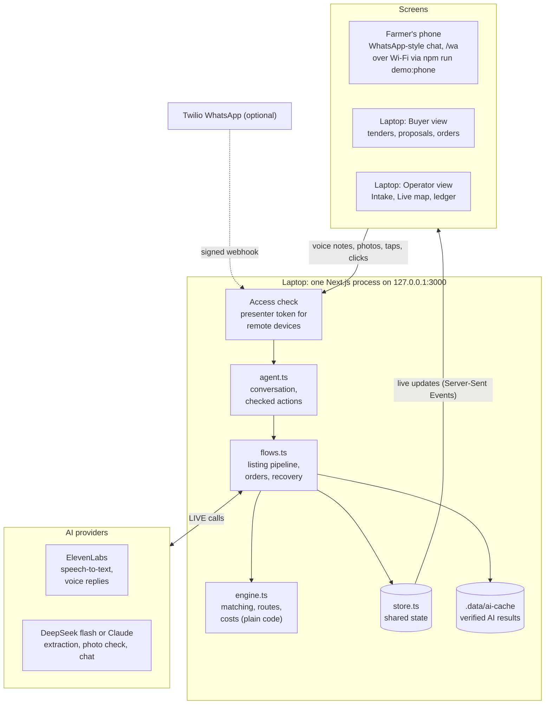
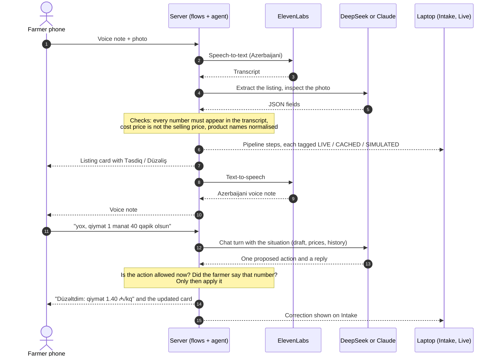

# BƏRƏKƏT

Many small farms, woven into one reliable supply. A demo for the YUNEX 2026 Digital Inclusion hackathon.

Farmers sell through WhatsApp in Azerbaijani (voice notes, photos, one-tap replies). Buyers and the
operations team use one web platform with a Buyer / Operator switch. All people and businesses in the demo
data are fictional, and escrow and payouts are simulated: no real money moves.

## How it works

One Node.js process holds the whole demo state and pushes every change to every screen. Farmers use a
WhatsApp-style screen on their own phones; buyers and operators use the laptop.



Every AI step is labelled on screen: **LIVE** (a provider call now), **CACHED** (the provider's earlier result for
the same input) or **SIMULATED** (scripted). The matching engine is plain code: the AI never decides who is
matched, it only reads voice notes and photos, talks to farmers and explains.

What happens to one farmer message:



## Run it

```bash
npm run demo:setup      # install, create .env.local, generate the presenter token, list what only you can do
npm run demo:doctor     # PASS / WARN / FAIL diagnostic (verifies keys with free read-only calls)
npm run demo:verify     # build, tests, HTTP + browser end-to-end, minimal real-AI smoke tests
npm run demo:launch     # the presentation command: one server on 127.0.0.1:3000, Act 1
```

| Command | Does |
|---|---|
| `demo:setup` | Safe to repeat. Never overwrites keys, recordings or photos. |
| `demo:doctor [-- --offline]` | Providers, Twilio, phones, tunnel, assets, fonts, tests, build, port, fallback, timeline. "Verified" means the provider accepted the key just now. |
| `demo:verify [-- --no-live] [-- --fresh]` | Ends with a table of exactly what was tested how: LIVE, CACHED, LOCAL, SIMULATED, NOT TESTED. Paid AI calls are tiny and cached. |
| `demo:assets [-- --fix] [-- --normalize] [-- --ai]` | Checks `public/demo`, converts formats, normalises loudness, transcribes/inspects with the real AI. |
| `demo:phone [-- stop\|status]` | Real phones on the same Wi-Fi become the farmers' WhatsApp (`/wa`): HTTPS relay on :3443, QR codes in the terminal and at `/connect`. |
| `demo:tunnel [-- stop\|status]` | Public HTTPS tunnel (ngrok if configured, else cloudflared), checks the webhook, prints the one Twilio Console step. |
| `demo:launch [-- --ai=live\|cached\|simulated] [-- --whatsapp=simulator\|twilio] [-- --resume]` | Preflight, build if needed, start, health check, readiness summary. Refuses to start a second server. |
| `demo:mode [-- --ai=…] [-- --whatsapp=…] [-- --save]` | Switch modes on the running app (same as **F** / **W**). |
| `demo:reset` | Back to the start of Act 1. |
| `demo:rehearse [-- --size=all] [-- --ai=live]` | Plays all four acts in Chrome, asserts every act, screenshots, timing. |
| `demo:fallback` | Proves the backup plan: whole demo with all keys removed, the **L** shortcut, restart recovery, cache coverage. |
| `demo:whatsapp-test` | Guided test with real phones: tells you what to send and checks each step. |
| `demo:stop` | Stops the server and the tunnel. |

The presenter runbook is in [RUNBOOK.md](RUNBOOK.md); the current state of readiness in
[DEMO_READINESS.md](DEMO_READINESS.md). `npm test` runs the engine and demo-flow tests without keys.

Live sync between the phone, Buyer and Operator views uses Server-Sent Events from a single in-memory state
in one Node process, snapshotted to `.data/` so a restart can resume (`demo:launch -- --resume`).

## The 3-minute demo

The farmer's phone is docked on the left (press **P** to hide it). Press **?** for all presenter keys.

1. **A voice note becomes a listing.** Operator → Intake. In the phone, tap **+** → *Voice note + photo*.
   The pipeline runs: transcript, fields, ripeness from the photo, price check, draft. Tap **Təsdiq**.
2. **Three farms, one order.** Press **B**, open tender T-1042, **Find supply**. Show margin note 2
   (the cheapest lot arrives overripe). **Confirm option i**. Tap **Qəbul** on Elşən's phone, press **A**.
3. **A farmer drops out.** Press **S** (Səbinə says hello, which opens her WhatsApp window), then **C**:
   Rauf cancels by voice, the view jumps to Operator → Live, the weave shows the 80 kg gap.
   **Approve and send offer**, then tap **Qəbul** on Səbinə's phone. The weave closes.
4. **Delivered and trusted.** Press **T** (Thursday 09:00), open the order as Buyer, **Confirm receipt**,
   rate the farmers. Reply **5** from Elşən's phone to rate the buyer.

Fallbacks: **L** puts Elşən's listing live if Act 1 fails. **F** cycles the AI mode LIVE → CACHED → SIMULATED
(the header chip always shows which). **R** resets everything.

Demo numbers (from the real engine, see `src/lib/engine.test.ts`): options at 1.33 / 1.23 / 1.38 ₼/kg,
and 1.35 ₼/kg after Səbinə replaces Rauf.

## The farmer's WhatsApp assistant

Farmers chat, they don't fill forms. Every free-form message (typed, or a voice-note transcript) goes to the
assistant (`src/lib/agent.ts`) with the situation: the listing being drafted, a pending offer, an accepted order,
the last messages and today's prices. The model proposes one action and a short Azerbaijani reply; code checks it.

- Farmers can correct anything in plain words ("yox, qiymət 1 manat 40 qəpik olsun", "350 kilo yaz"), ask
  questions ("bu qiymət bazara uyğundur?"), confirm ("hə, düzdür") or withdraw. **Düzəliş** asks what to fix.
- A listing is drafted even without a photo; the photo can come later and is added to the same listing.
- Cost vs selling price is told apart ("mayası 1.25, 1.50-yə satacam" → 1.50, cost kept in the notes); when
  two prices were said, the card asks the farmer to confirm.
- Safety: only actions that fit the situation are applied; a number the farmer did not say is never applied;
  confirmations are written from what was actually changed; a chat reply never claims it changed anything.
  One farmer's messages are processed strictly in order.
- Clear messages (produce + quantity/price, "qəbul", "göndərə bilmirəm") skip the model, so the main demo path
  makes no extra AI call. On a bad network a chat turn falls back to rules after 12 s; with a verified cached
  result available, a slow live call falls back after 8 s; a provider that just failed is skipped for 45 s.
- The Intake screen shows what the assistant is waiting for and every correction made in the chat.

### Voice replies

Every assistant message can also arrive as an Azerbaijani voice note (ElevenLabs `eleven_v4_turbo`, native
Azerbaijani voice "Ibrahim Mammadli"), for farmers who would rather listen than read. Cards are spoken as one
natural sentence with numbers and money in words ("yüz səksən kilo, bir manat on beş qəpik"). The text goes out
at once and the voice note follows. On WhatsApp it is a real voice note; in the app, a play button, and the 🔊
button on the docked phone plays replies aloud for the audience. Clips are cached (`.data/tts`), so each phrase
is paid once; CACHED mode only replays clips, SIMULATED makes none. **V** or `demo:mode -- --voice=on|off`.

## Real vs simulated

| Real | Simulated, and labeled |
|---|---|
| Azerbaijani speech-to-text (ElevenLabs `scribe_v2`, `language_code=aze`) | Escrow and payouts |
| Listing extraction and photo ripeness/defects (Claude, or DeepSeek `deepseek-flash` via its Anthropic-compatible API) | Truck movement and the demo clock |
| Cancellation intent from a voice note | Other farmers' replies when you press **A** |
| Matching, combining farms, routing, cost, re-matching (`src/lib/engine.ts`) | WhatsApp delivery in simulator mode |
| Live sync, order states, ratings | |

Every AI result is labelled per step on the Intake screen: **LIVE** (provider call now), **CACHED** (a result
the provider returned earlier for the same input, stored in `.data/ai-cache/`) or **SIMULATED** (scripted).
Without keys the app uses scripted transcripts and an offline Azerbaijani extractor. Photo checks are visual
estimates, not food-safety certification.

## Real WhatsApp (Twilio sandbox)

1. In the Twilio Console, open the WhatsApp sandbox. Each teammate sends `join <code>` to
   +1 415 523 8886 from their phone. Rejoin within 3 days of the demo.
2. Put the keys and `FARMER_PHONES` in `.env.local`. Only those numbers are accepted; others are ignored.
3. `npm run demo:tunnel` and paste the printed URL into the sandbox's *When a message comes in* (POST).
4. Press **W** in the app (or `npm run demo:mode -- --whatsapp=twilio`). Messages to mapped phones now go out
   through Twilio, and the docked phone mirrors the real conversations.
5. `npm run demo:whatsapp-test` walks through the real round trip step by step.

Security when the app is public: it listens on 127.0.0.1 only; anything arriving through the tunnel needs the
presenter token (`?key=<DEMO_ADMIN_TOKEN>` once, then a cookie); the webhooks check Twilio's signature,
drop retries by MessageSid, refuse non-Twilio media URLs, and queue messages durably in `.data/inbox/`.

Sandbox rules to remember: free-form replies only within 24 hours of the farmer's last message (press
**S** or have Səbinə text before Act 3), one message every 3 seconds (sends are queued), and no custom
buttons, so offers ask the farmer to reply 1 or 2.

## Demo assets

Put real recordings and photos in `public/demo/` (names in `public/demo/README.md`). Without them the
demo uses scripted transcripts and SVG placeholders.

## Code map

- `src/lib/engine.ts` matching, aggregation, routing, recovery, and reasons written from the numbers
- `src/lib/flows.ts` WhatsApp conversation, AI listing pipeline, orders, cancellation, presenter controls
- `src/lib/ai.ts` ElevenLabs, Claude, caching, offline extractor
- `src/lib/store.ts` shared state, demo clock, ledger, Twilio sender
- `src/app/buyer`, `src/app/operator` the two perspectives; `src/components/Phone.tsx` the farmer's phone

Before the pitch: check prices against real local wholesale prices, and confirm the fonts render Ə, ğ and ı
on the presentation laptop.
